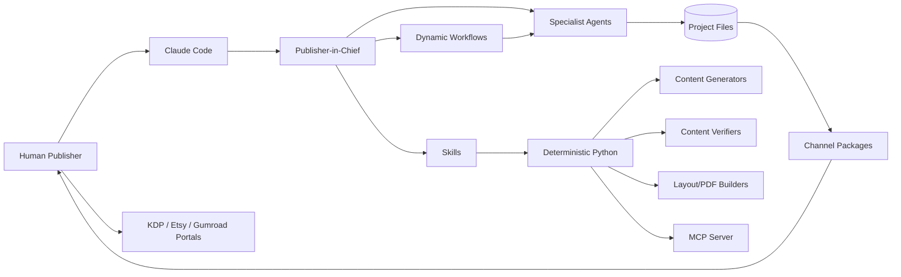

# Architecture

## ARC-001 — System context

The framework treats Claude Code as the interactive and non-interactive agent
runtime. The `.claude` directory is the canonical company definition. Deterministic
Python code owns business state, validation, hashing, **content generation**,
**independent content verification**, approvals, rights gates, packaging, and release
safety.

## ARC-002 — Component boundaries

| Component | Owns | Does not own |
|---|---|---|
| `CLAUDE.md` and rules | Persistent operating policy | State transitions or external side effects |
| Agents | Expert reasoning and artifact production/review | Self-approval, self-verification, release authorization |
| Skills | Repeatable stage procedures | Durable state by themselves |
| Dynamic workflows | Parallel fan-out/fan-in orchestration | Mid-run human approval or direct filesystem access |
| Hooks | Deterministic prevention and audit | Creative/editorial judgment |
| Python scripts | State, schemas, hashes, generation, verification, builds, packages | Subjective content decisions |
| MCP server | Safe programmatic access to local functions | Live publication |
| Human publisher | Approval, legal/commercial authority, release | Routine generation and validation |

## ARC-003 — Data flow

1. A human or discovery agent records a niche opportunity with dated evidence.
2. Niche assessment scores the opportunity; the human grants the niche gate.
3. Planning fixes the product spec, audience band, and design policy.
4. Generators produce content batches **deterministically from a seed** by code.
5. A separate verifier **independently checks** solvability, uniqueness, answer keys, and difficulty by code — the generator never self-certifies.
6. Independent reviewers emit structured findings; revision agents resolve accepted findings; code re-verifies.
7. The interior gate freezes the verified batches by hash before visual, layout, and packaging work.
8. Line art is produced original-only, reviewed for originality/printability, then the cover gate runs.
9. Deterministic builders create interior/cover/digital artifacts and preflight reports.
10. Rights, accessibility, and compliance gates run; then metadata and listing gates.
11. Channel adapters produce checksum-verified upload packages and register each package-manifest hash.
12. Two humans grant release authorization against exact package hashes; manual or separately enabled external submission is reconciled into project events.

## ARC-004 — Persistence

No database server is required. Each project contains:

- `project.yaml`: approved product specification;
- `state.json`: current machine-readable state;
- `events.ndjson`: append-only audit history;
- `artifacts/manifest.json`: content-addressed artifact registry;
- `content/verification/*.json`: code-verification results per batch;
- `approvals/*.json`: signed-off gate records;
- `rights/ledger.json`: rights evidence and clearance status.

A series links products via `series/<series-id>/series.yaml`; it never creates a
series-level approval, freeze, or release that bypasses a product's human gates.

## ARC-005 — Reliability

- Atomic file replacement protects state writes.
- File locks prevent two local processes from transitioning one project concurrently.
- SHA-256 binds reviews, verifications, and approvals to exact artifacts.
- Every state mutation appends an event.
- Generation is deterministic from a seed; verification is reproducible.
- Build and package commands are idempotent by target path and source hashes.
- External operations remain disabled until a separately reviewed connector is installed.

## ARC-006 — Extension points

- New agent: add `.claude/agents/<department>/<agent>.md` and an evaluation fixture.
- New skill: add `.claude/skills/<skill>/SKILL.md` and reference deterministic scripts where possible.
- New content type: implement a generator under `publishing_house/generators/` plus its independent verifier in `verify.py`.
- New format: implement a builder and preflight validator, then extend the design policy.
- New channel: implement the channel adapter contract and keep live writes disabled by default.
- New MCP service: register it in `.mcp.json`, scope tools to the minimum agents, and document data handling.
